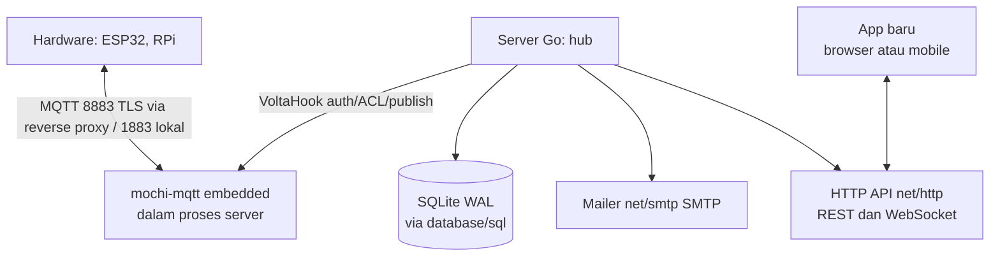

# VOLTA.


Server IoT MQTT-only yang dibangun dengan Go. Perangkat keras berkomunikasi via MQTT, server menyimpan state pin, dan aplikasi mengambil data lewat HTTPS REST dan WebSocket. Protokol binary TCP lama tidak dipakai.

Status: implementasi Fase 1-5 selesai (port Go 1:1 dari Rust; kode Rust telah dihapus). Rencana lengkap ada di `tasks/plan.md`.

## Arsitektur



Satu biner berisi broker MQTT, HTTP, mailer, dan storage. Tidak ada layanan terpisah untuk dijalankan.

## Topik MQTT

| Topik | Arah | QoS | Retained |
|---|---|---|---|
| `volta/dev/{device_id}/state/{pin}` | device ke server | 1 | ya |
| `volta/dev/{device_id}/cmd/{pin}` | server ke device | 1 | tidak |
| `volta/dev/{device_id}/status` | LWT saat connect | 1 | ya |
| `volta/dev/{device_id}/log` | device ke server | 0 | tidak |

Autentikasi device memakai token 32 karakter sebagai username sekaligus password MQTT. Token dapat dicabut; koneksi aktif ikut diputus. Satu device hanya boleh menulis state dan log miliknya, dan hanya subscribe cmd serta status miliknya.

## Stack

- **Go + goroutine**: runtime, worker antrean, sweeper presence
- **mochi-mqtt v2**: broker MQTT terbenam, dihubungkan lewat `VoltaHook`
- **net/http + gorilla/websocket**: HTTP REST, WebSocket, static
- **database/sql + mattn/go-sqlite3**: penyimpanan dengan mode WAL; adaptor Postgres menyusul lewat interface `Storage`
- **net/smtp**: SMTP, STARTTLS port 587 atau SMTPS port 465
- **flag, log, encoding/json, BurntSushi/toml, google/uuid**: CLI, log, model, config, id

## Guna memulai

```sh
go build ./...
go run ./cmd/volta --data-folder ./data
```

Port bawaan: 8883 MQTT TLS (via reverse proxy), 1883 MQTT lokal, 9443 HTTPS app.

## Benchmark

Ukur request per menit ke endpoint HTTP (default `/healthz`):

```sh
go run ./cmd/bench --host 127.0.0.1 --port 9443 --duration-secs 60 --concurrency 10
```

Contoh output: `total 120000 | gagal 0 | 60.1 dtk | 119800 req/menit (1997 req/detik)`.

## Mailer

Config `mailer.toml` di folder data:

```toml
[smtp]
host = "smtp.example.com"
port = 587
tls = "starttls"
username = "no-reply@example.com"
password = "REPLACE_ME"
from = "\"VOLTA.\" <no-reply@example.com>"

[queue]
max = 10000
```

Email register, reset password, dan event pin berjalan melalui antrean dengan retry. Status mailer terlihat di `healthz`.

## Peta modul

| Modul | Isi |
|---|---|
| `broker` | mochi-mqtt terbenam, hook auth token, presence, status |
| `topics` | parse topik, ACL publish/subscribe |
| `pins` | tap state, command bus, history |
| `http` | REST auth, dashboard, device, pins, WS stream |
| `mailer` | net/smtp transport, antrean, template |
| `storage` | SQLite WAL, interface Storage |
| `rule` | eventor, timer |

## Status proyek

Rencana dipetakan di `tasks/plan.md` (Fase 1 hingga 4, 15 task, mailer wajib di Fase 1).

## Logo

Identitas Bit Pair (kotak solid 1/HIGH + ring 0/LOW). Master vektor di
`assets/logo/` (`volta-horizontal.svg` primer, `volta-symbol.svg` untuk ikon).
Aturan pakai: `assets/logo/VOLTA-guidelines.md` — zona aman 1× tinggi kotak,
lebar minimum horizontal 96 px / simbol 16 px, palet Ink `#111111`, Copper
`#C07A24`, Steel `#7C8288`, Paper `#F5F3EE`. CLI mencetak banner ASCII saat
start dan `--help` menampilkan tampilan teks yang sama.

## Firmware

Klien device ESP32 (Arduino + PlatformIO) di `firmware/`: library OOP
non-blocking `VoltaESP32` dan proyek demo `platformio.ini`. Detail:
`firmware/README.md`.

## Webapp

Klien web (Next.js + TSX, Tailwind, shadcn/ui) direncanakan di
`tasks/plan-webapp.md`, checklist di `tasks/todo-webapp.md`.
Implementasinya nanti tinggal di `webapp/`.

## Lisensi

MIT sesuai upstream, menyesuaikan setelah rilis.
