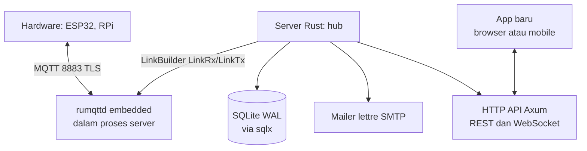

# VOLTA.


Server IoT MQTT-only hasil pembangunan ulang dalam bahasa Rust. Hardware berbicara MQTT, server menyimpan state pin, dan aplikasi baru mengambil data lewat HTTPS REST dan WebSocket. Protokol binary TCP lama tidak dipakai.

Status: implementasi Fase 1-4 selesai. Rencana lengkap ada di `tasks/plan.md`.

## Arsitektur



Satu biner berisi broker MQTT, HTTP, mailer, dan storage. Tidak ada layanan terpisah untuk dijalankan.

## Topik MQTT

| Topik | Arah | QoS | Retained |
|---|---|---|---|
| `volta/dev/{device_id}/state/{pin}` | device ke server | 1 | ya |
| `volta/dev/{device_id}/cmd/{pin}` | server ke device | 1 | tidak |
| `volta/dev/{device_id}/status` | LWT saat connect | 1 | ya |
| `volta/dev/{device_id}/log` | device ke server | 0 | tidak |

Auth device berupa token 32 karakter sebagai username dan password MQTT. Token dapat direvoke dan koneksi aktif akan diputus. Satu device hanya boleh menulis state dan log miliknya sendiri, dan hanya subscribe cmd serta status miliknya.

## Stack

- **Tokio**: runtime, task per koneksi, worker antrean
- **rumqttd**: broker MQTT embedded, dikepang lewat `LinkBuilder`
- **Axum**: HTTP REST, WebSocket, static
- **sqlx + SQLite**: penyimpanan, diatur WAL; adapter Postgres menyusul lewat trait `Storage`
- **lettre**: SMTP async, STARTTLS port 587 atau smtps port 465
- **rustls-acme**: sertifikat Let's Encrypt otomatis
- **serde, clap, tracing**: model, CLI, log

## Guna memulai

Cara menjalankan:

```sh
cargo build --release
./target/release/volta --dataFolder ./data
```

Port yang direncanakan: 8883 MQTT TLS, 1883 MQTT lokal, 9443 HTTPS app.

## Benchmark

Ukur request per menit ke endpoint HTTP (default `/healthz`):

```sh
cargo run --bin bench -- --host 127.0.0.1 --port 9443 --duration-secs 60 --concurrency 10
```

Contoh output: `total 120000 | gagal 0 | 60.1 dtk | 119800 req/menit (1997 req/detik)`.

## Mailer

Config `mailer.toml` di folder data:

```toml
[smtp]
host = "smtp.example.com"
port = 587
tls = "starttls"
username = "no-reply@example.com"
password = "REPLACE_ME"
from = "\"VOLTA.\" <no-reply@example.com>"

[queue]
max = 10000
```

Email register, reset password, dan event pin berjalan melalui antrean dengan retry. Status mailer terlihat di `healthz`.

## Peta modul yang direncanakan

| Modul | Isi |
|---|---|
| `src/broker` | embed rumqttd, TLS, auth token, LWT |
| `src/pins` | tap state, command bus, history |
| `src/http` | REST auth, dashboard, device, pins, WS stream |
| `src/mailer` | lettre transport, antrean, template |
| `src/storage` | SQLite via sqlx, trait Storage |
| `src/rule` | eventor, timer, webhook |

## Status proyek

Rencana dipetakan di `tasks/plan.md` (Fase 1 hingga 4, 15 task, mailer wajib di Fase 1).

## Logo

Identitas Bit Pair (kotak solid 1/HIGH + ring 0/LOW). Master vektor di
`assets/logo/` (`volta-horizontal.svg` primer, `volta-symbol.svg` untuk ikon).
Aturan pakai: `assets/logo/VOLTA-guidelines.md` — zona aman 1× tinggi kotak,
lebar minimum horizontal 96 px / simbol 16 px, palet Ink `#111111`, Copper
`#C07A24`, Steel `#7C8288`, Paper `#F5F3EE`. CLI mencetak banner ASCII saat
start dan `--help` menampilkan lockup teks yang sama.

## Firmware

Klien device ESP32 (Arduino + PlatformIO) di `firmware/`: library OOP
non-blocking `VoltaESP32` dan proyek demo `platformio.ini`. Detail:
`firmware/README.md`.

## Lisensi

MIT sesuai upstream, menyesuaikan setelah rilis.
