# Blynk Server Lokal - Peta Cara Kerja

Dokumen ini memetakan cara kerja `blynk-server/` yang ada di repo ini. Sumber utama adalah kode di `blynk-server/server/`, `blynk-server/client/`, `blynk-server/integration-tests/`, `blynk-server/apiary.apib`, dan `blynk-server/README.md`.

Catatan analisis: repo ini adalah source lengkap, jadi pemetaan memakai pembacaan source langsung, bukan tool binary atau runtime REA. Skill `reverse-engineer-anything` tidak dijalankan untuk target semacam ini sesuai aturannya.

Status upstream: Blynk Legacy ini sudah discontinued. Cloud Legacy dimatikan. Server lokal tetap bisa jalan sebagai arsip atau untuk perangkat lama.

## 1. Konteks sistem

Ada 3 pihak: aplikasi mobile, hardware, dan server. Server meneruskan pesan di antara keduanya, menyimpan profil, dan menyediakan HTTP API, WebSocket, MQTT, halaman admin, dan notifikasi.

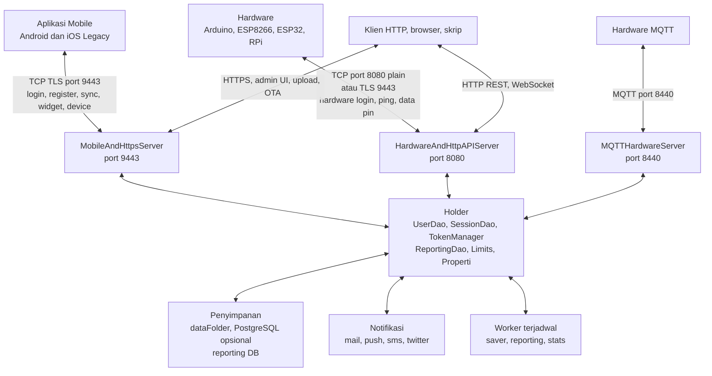

## 2. Modul repo

| Modul | Isi |
|---|---|
| `server/core` | Model User, DashBoard, Device, widget, protokol Command, DAO token dan sesi, reporting mentah dan agregat, Eventor, Webhook, util internal |
| `server/tcp-app-server` | Handler aplikasi mobile: auth, dashboard, device, tag, widget, tile, face, sharing, graph, reporting, energy, provision |
| `server/tcp-hardware-server` | Handler hardware: login, ping, hardware data, sync, bridge, internal, mail, push, sms, twit, property, MQTT |
| `server/http-api` | REST pin dan project, notify, email, QR, clone, history, OTA trigger, reset password, auth admin |
| `server/http-core` | Framework anotasi Path GET POST PUT DELETE, router URL, static file, upload, OTA file handler |
| `server/http-admin` | API admin: config, hardware stats, OTA start stop, stats realtime, user CRUD |
| `server/launcher` | ServerLauncher, JobLauncher, 3 server Netty, 7 worker, parser argumen CLI |
| `server/notifications/email` | GMailClient, ThirdPartyMailClient, template QR dan reset |
| `server/notifications/push` | GCMWrapper Android dan iOS |
| `server/notifications/sms` | SMSWrapper |
| `server/notifications/twitter` | TwitterWrapper |
| `server/acme` | AcmeClient untuk sertifikat LetsEncrypt otomatis |
| `server/utils` | Properti server mail sms gcm twitter db, validator, struktur antrean, hash, file |
| `server/tools` | ForwardingTokenGenerator, ReportingDataCleaner |
| `client` | HardwareClient, AppClient, ActiveHardwareClient, CommandParserUtil, ClientLauncher |
| `integration-tests` | Uji TCP, HTTP, HTTPS, WebSocket, OTA, upload, reset password |
| `scripts`, `server/Docker` | Skrip start, ulimit, db, image Docker |

## 3. Boot server

`ServerLauncher` membaca argumen CLI dan properti, membangun `Holder`, lalu menyalakan 3 server dan worker terjadwal di `JobLauncher`.

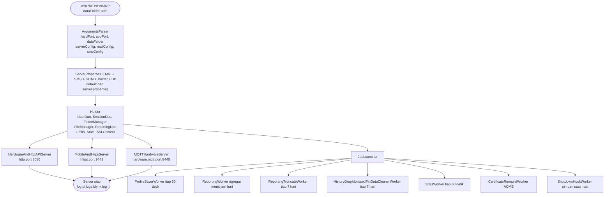

Argumen CLI yang didukung: `-dataFolder`, `-hardPort`, `-appPort`, `-serverConfig`, `-mailConfig`, `-smsConfig`, `-dbConfig`.

## 4. Port dan pipeline Netty

| Server | Port default | Isi pipeline |
|---|---|---|
| `HardwareAndHttpAPIServer` | 8080 | Unifikasi hardware atau HTTP, MessageDecoder dan Encoder, HardwareLoginHandler, HardwareHandler, HttpAPILogic, ResetPasswordHttpLogic, WSHandler di path websocket, LetsEncryptHandler, static file |
| `MobileAndHttpsServer` | 9443 TLS | MobileLoginHandler, MobileRegisterHandler, MobileHandler, MobileShareHandler, HardwareLoginHandler, AdminAuthHandler dan UsersLogic ConfigsLogic StatsLogic, HttpAPILogic, UploadHandler, OTAHandler, WSHandler |
| `MQTTHardwareServer` | 8440 | MqttDecoder dan Encoder, MqttHardwareLoginHandler, MqttHardwareHandler |

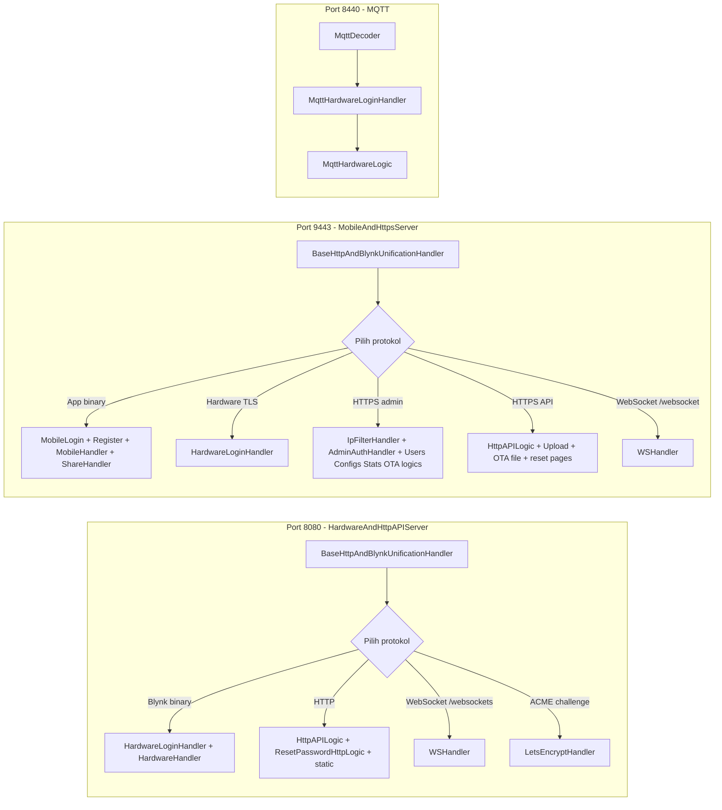

## 5. Protokol Blynk binary

Semua pesan binary memakai `Command` short 0 sampai 94 dan `MessageBase` dengan msgId. Encoder dan decoder ada 3 varian: biasa, mobile, dan WS.

Command yang ada di `Command.java`:

- Sistem: RESPONSE 0, PING 6, GET_SERVER 40, CONNECT_REDIRECT 41
- Auth app: REGISTER 1, LOGIN 2, LOGOUT 66, RESET_PASSWORD 81, REDEEM 3, ADD_ENERGY 37, GET_ENERGY 36
- Dashboard app: CREATE_DASH 21, UPDATE_DASH 22, DELETE_DASH 23, UPDATE_PROJECT_SETTINGS 38, LOAD_PROFILE_GZIPPED 24, APP_SYNC 25, ACTIVATE_DASHBOARD 7, DEACTIVATE_DASHBOARD 8
- Device dan tag: CREATE_DEVICE 42, UPDATE_DEVICE 43, DELETE_DEVICE 44, GET_DEVICES 45, MOBILE_GET_DEVICE 50, CREATE_TAG 46, UPDATE_TAG 47, DELETE_TAG 48, GET_TAGS 49
- Widget: CREATE_WIDGET 33, UPDATE_WIDGET 34, DELETE_WIDGET 35, GET_WIDGET 70, SET_WIDGET_PROPERTY 19
- Tile template: CREATE_TILE_TEMPLATE 67, UPDATE_TILE_TEMPLATE 68, DELETE_TILE_TEMPLATE 69
- Face app: CREATE_APP 55, UPDATE_APP 56, DELETE_APP 57, UPDATE_FACE 51
- Sharing: SHARING 26, GET_SHARE_TOKEN 30, REFRESH_SHARE_TOKEN 31, SHARE_LOGIN 32
- Token: REFRESH_TOKEN 9, ASSIGN_TOKEN 39, GET_PROVISION_TOKEN 74
- Graph dan data: HARDWARE 20, HARDWARE_SYNC 16, EXPORT_GRAPH_DATA 28, GET_ENHANCED_GRAPH_DATA 60, DELETE_ENHANCED_GRAPH_DATA 61, DELETE_DEVICE_DATA 76
- Event dan webhook: EVENTOR 53, WEB_HOOKS 54, BLYNK_INTERNAL 17, BRIDGE 15, RESOLVE_EVENT 75, TRACK_DEVICE 73
- Notifikasi hardware: TWEET 12, EMAIL 13, PUSH_NOTIFICATION 14, SMS 18, ADD_PUSH_TOKEN 27
- Hardware status: HARDWARE_CONNECTED 4, HARDWARE_LOGIN 29, HARDWARE_LOG_EVENT 64, HARDWARE_RESEND_FROM_BLUETOOTH 65, DEVICE_OFFLINE 71
- Clone dan QR: GET_CLONE_CODE 62, GET_PROJECT_BY_CLONE_CODE 63, GET_PROJECT_BY_TOKEN 58, EMAIL_QR 59
- Layar: WEB_SOCKETS 52, OUTDATED_APP_NOTIFICATION 72
- Report: CREATE_REPORT 77, UPDATE_REPORT 78, DELETE_REPORT 79, EXPORT_REPORT 80
- Statistik HTTP: 82 sampai 94 untuk hitung request REST

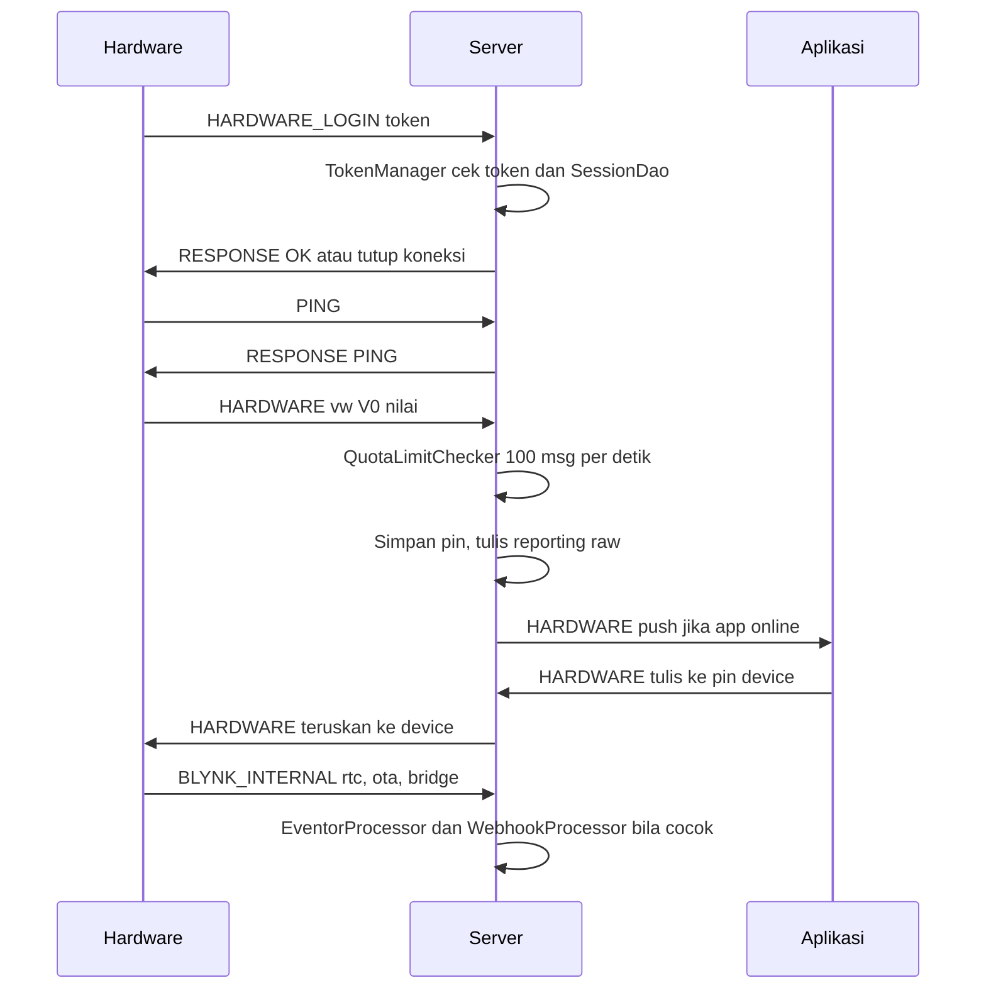

## 6. Flow aplikasi mobile

```mermaid
flowchart TD
    REG[REGISTER email dan pass] --> LOGIN[LOGIN user dan pass atau token]
    LOGIN --> LOAD[LOAD_PROFILE_GZIPPED<br/>profil gzip dari FileManager]
    LOAD --> SYNC[APP_SYNC semua device]
    SYNC --> DASH{Kelola dashboard}
    DASH --> CD[CREATE_DASH]
    DASH --> UD[UPDATE_DASH]
    DASH --> DD[DELETE_DASH]
    DASH --> ACT[ACTIVATE dan DEACTIVATE_DASHBOARD]
    SYNC --> DEV{Kelola device}
    DEV --> CDEV[CREATE_DEVICE]
    DEV --> UDEV[UPDATE_DEVICE]
    DEV --> DDEV[DELETE_DEVICE]
    DEV --> GDEV[GET_DEVICES dan MOBILE_GET_DEVICE]
    SYNC --> TAG{Kelola tag}
    TAG --> CTAG[CREATE_TAG]
    TAG --> UTAG[UPDATE_TAG]
    TAG --> DTAG[DELETE_TAG]
    TAG --> GTAG[GET_TAGS]
    SYNC --> WDG{Kelola widget}
    WDG --> CW[CREATE_WIDGET]
    WDG --> UW[UPDATE_WIDGET]
    WDG --> DW[DELETE_WIDGET]
    WDG --> GW[GET_WIDGET]
    WDG --> SWP[SET_WIDGET_PROPERTY]
    SYNC --> TILE{Kelola tile template}
    TILE --> CTT[CREATE_TILE_TEMPLATE]
    TILE --> UTT[UPDATE_TILE_TEMPLATE]
    TILE --> DTT[DELETE_TILE_TEMPLATE]
    SYNC --> FACE{Kelola face app}
    FACE --> CA[CREATE_APP]
    FACE --> UA[UPDATE_APP]
    FACE --> DA[DELETE_APP]
    FACE --> UF[UPDATE_FACE]
    FACE --> MQR[EMAIL_QR kirim QR]
    SYNC --> SHR{Sharing}
    SHR --> GST[GET_SHARE_TOKEN]
    SHR --> RST[REFRESH_SHARE_TOKEN]
    SHR --> SHL[SHARE_LOGIN]
    SHR --> SHM[LoadSharedProfileGzippedLogic]
    SYNC --> NRG[GET_ENERGY, ADD_ENERGY, REDEEM, PURCHASE]
    SYNC --> REP{Kelola report}
    REP --> CR[CREATE_REPORT]
    REP --> UR[UPDATE_REPORT]
    REP --> DR[DELETE_REPORT]
    REP --> ER[EXPORT_REPORT kirim email]
    SYNC --> GRP[EXPORT_GRAPH_DATA dan GET_ENHANCED_GRAPH_DATA]
```

## 7. HTTP REST API

Base path memakai token device: `/{token}/...`. Semua update pin menulis ke app dan hardware sekaligus.

| Method dan path | Fungsi |
|---|---|
| `GET {token}/project` | Ambil JSON dashboard |
| `GET {token}/isHardwareConnected` | Status hardware |
| `GET {token}/isAppConnected` | Status app |
| `GET {token}/get/{pin}` | Baca nilai pin, misal V0 D8 A0 |
| `GET {token}/rtc` | Waktu RTC untuk hardware |
| `GET {token}/qr` | Unduh QR token |
| `GET {token}/data/{pin}?period=...&granularity=...` | Riwayat Superchart |
| `GET {token}/update/{pin}?value=...` | Tulis pin lewat GET |
| `PUT {token}/update/{pin}` body JSON | Tulis pin, contoh `["1"]` |
| `PUT {token}/pin/{pin}` | Alias tulis pin |
| `PUT {token}/extra/pin/{pin}` | Tulis pin multi nilai |
| `POST {token}/notify` | Kirim push dari HTTP |
| `POST {token}/email` | Kirim email dari HTTP |
| `GET {token}/clone` | Clone project |
| `GET /resetPassword`, `POST /resetPassword`, `GET /restore`, `POST /updatePassword`, `GET /landing` | Flow reset password lewat email |
| `POST /login`, `POST /logout` | Auth cookie admin |
| `GET /static/...`, `GET /favicon.ico` | File statis, redirect CSV, LetsEncrypt challenge |

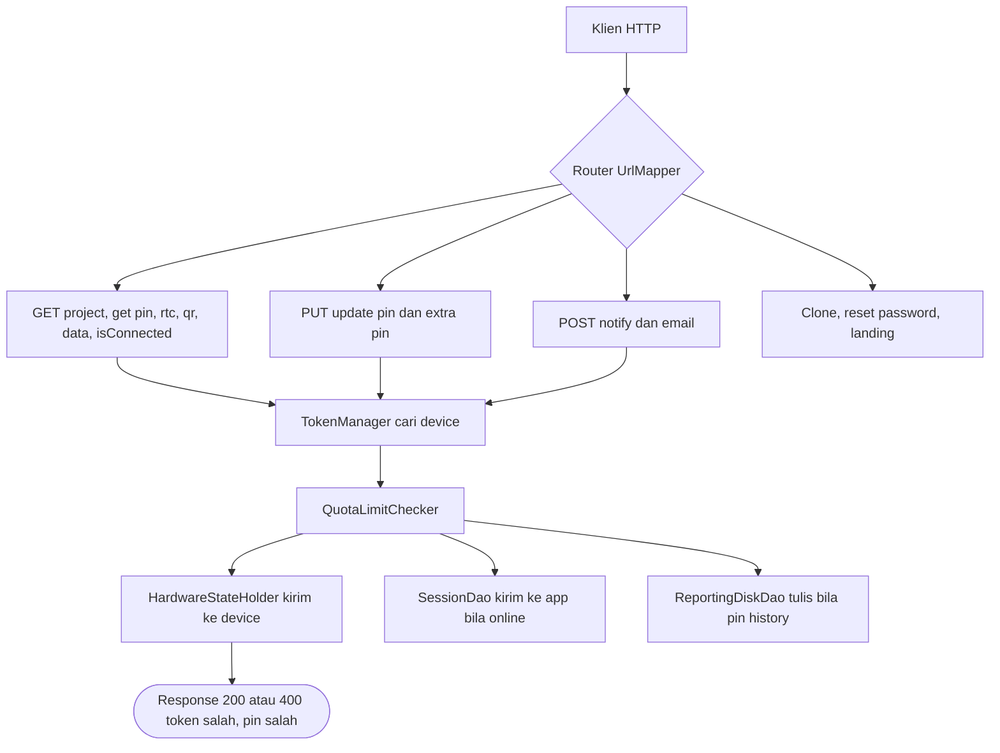

Upload dan OTA lewat HTTP:

- `UploadHandler` menerima file firmware atau resource dan menyimpan ke folder data.
- `OTAHandler` menyajikan file OTA ke hardware.
- `OTALogic` di admin memicu `HTTP_START_OTA` dan `HTTP_STOP_OTA` per token dan device.

## 8. WebSocket

Ada 2 path: `/websockets` di port 8080 dan `/websocket` di port 9443. `BaseWebSocketUnificator` memilih pipeline HTTP atau WebSocket dari request pertama. Setelah upgrade, `WSHandler` memakai decoder dan encoder WS dan perintah yang sama dengan TCP.

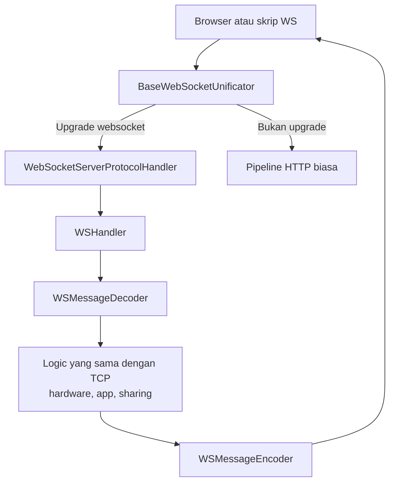

Dokumen contoh ada di `docs/websocket/`, termasuk `Command.js` dan halaman uji.

## 9. Admin UI dan Admin API

UI statis di `http-admin/resources/static/admin.html` dan `login.html`. Akses dibatasi `allowed.administrator.ips` dan login admin `admin.email` dan `admin.pass`.

| Path | Fungsi |
|---|---|
| `/admin` | Halaman admin |
| `/config`, `/config/{name}` GET dan PUT | Baca dan ubah properti server |
| `/hardwareInfo/blynkVersion`, `/cpuType`, `/connectionType`, `/boards` | Sebaran versi dan board |
| `/ota/start?token=...`, `/ota/stop` | Mulai dan stop OTA |
| `/stats/realtime`, `/requestsPerUser`, `/messages`, `/widgets`, `/projectsPerUser`, `/boards`, `/facebookLogins`, `/filledSpace`, `/userProfileSize`, `/webHookHosts`, `/ips` | Statistik pemakaian |
| `/users`, `/users/{id}` GET PUT DELETE, `/users/names/getAll`, `/users/token/assign`, `/users/token/force` | Kelola user dan token |

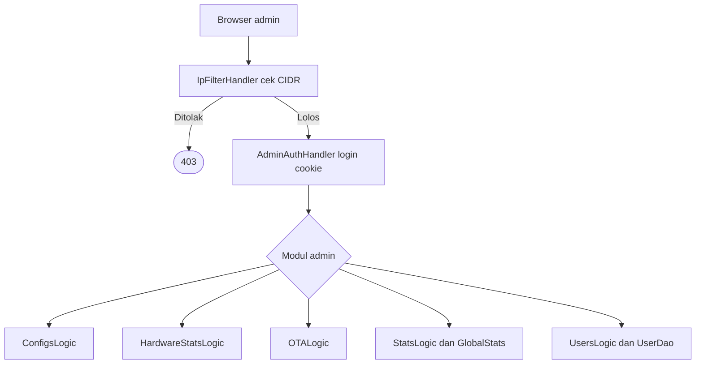

## 10. Notifikasi

Semua notifikasi lewat antrean `notifications.queue.limit` 2000 dan pool `blocking.processor.thread.pool.limit` 6. Ada jeda `notifications.frequency.user.quota.limit` detik per user agar tidak spam.

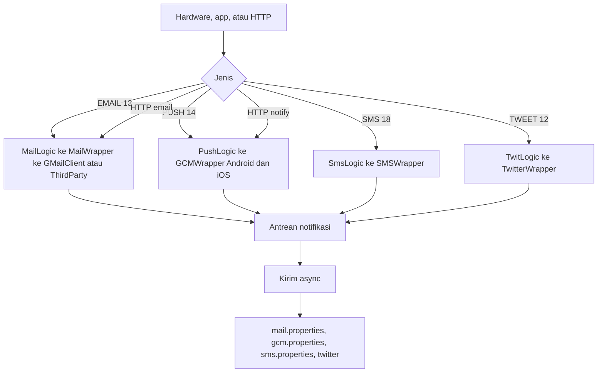

File properti contoh ada di tiap modul notifikasi. Tanpa file yang benar, kirim akan gagal dan masuk log.

## 11. Reporting dan history

Ada 2 jalur: file disk untuk CSV dan Superchart cepat, dan PostgreSQL opsional untuk data mentah dan agregat.

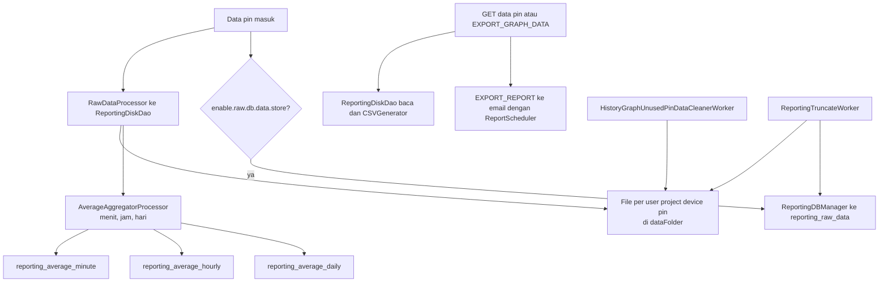

Fungsi agregat di `dao/functions`: Average, Min, Max, Sum, Median, GraphFunction. Export dibatasi `csv.export.data.points.max` 43200.

## 12. OTA firmware

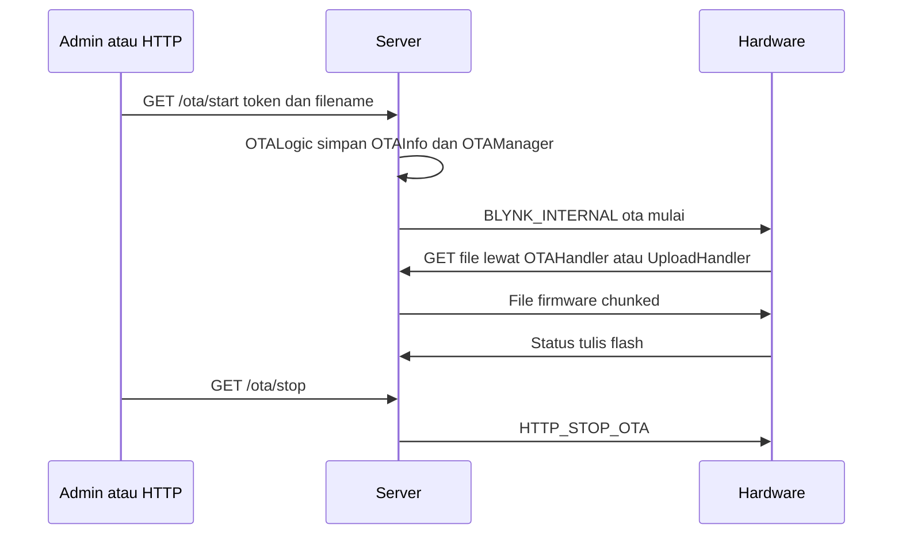

## 13. Sharing, clone, dan provision

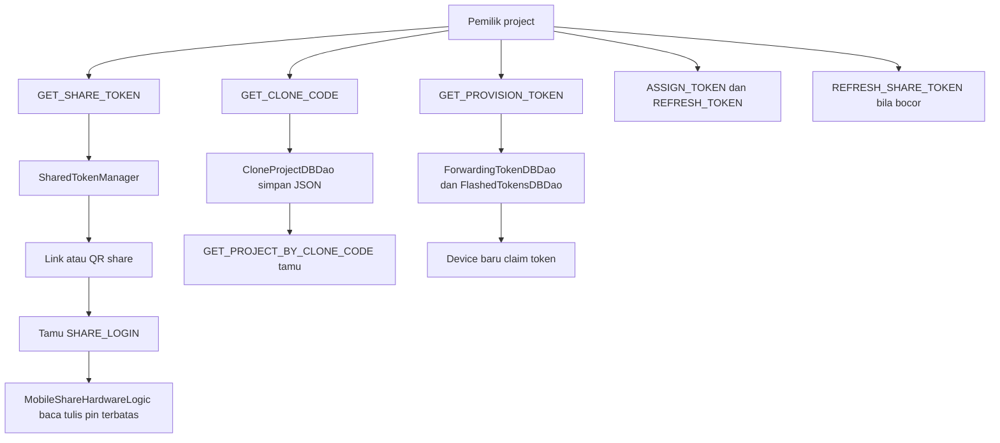

## 14. Eventor, webhook, dan timer

- `EventorProcessor` menilai Rule berisi kondisi angka atau string dan aksi SetPin, Notify, Mail, Twit. Kondisi: Between, Equal, GreaterThan, LessThan, dan varian OrEqual, NotBetween, NotEqual, StringEqual, ValueChanged, plus TimerTime.
- `WebhookProcessor` memanggil URL di widget WebHook dengan batas `webhooks.frequency.user.quota.limit` 1000 ms dan `webhooks.response.size.limit` 96 KB.
- `TimerWorker` dan `TimerWidget` menjalankan aksi terjadwal per device.
- `ReadingWidgetsWorker` memicu baca sensor bila app offline diizinkan oleh `allow.reading.widget.without.active.app`.
- `BridgeLogic` meneruskan pin antar device dalam project yang sama lewat token bridge.

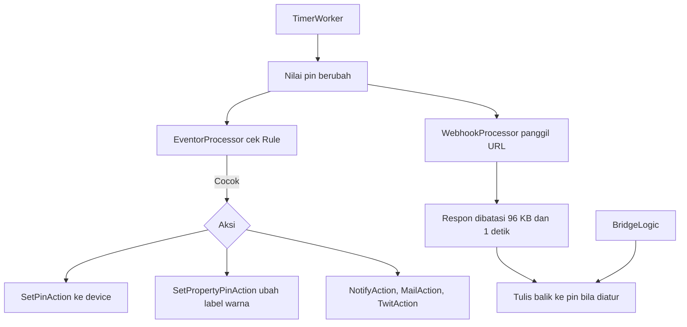

## 15. Widget yang didukung

Semua widget di bawah memakai pin virtual atau digital, kecuali yang bertanda tanpa pin.

Kontrol: Button, StyledButton, Switch, Slider, VerticalSlider, Step, VerticalStep, NumberInput, TextInput, Terminal, RGB, TwoAxisJoystick, SegmentedControl, Timer, LinkButton, QR.

Output: Gauge, LCD, LED, LabeledValueDisplay, ValueDisplay, LevelDisplay, VerticalLevelDisplay, Map, Superchart, Table, Menu.

Sensor: Accelerometer, Barometer, GPSStreaming, GPSTrigger, Gravity, Humidity, Light, Proximity, Temperature.

Lain: Bluetooth, BluetoothSerial, Bridge, Eventor, Player, RTC, TextWidget, Video, WebHook.

UI dan struktur: DeviceSelector, Image, Tabs dan Tab, Table dengan Column dan Row, DeviceTiles dengan Tile dan TileTemplate Button Dimmer Page, TimeInput, ReportingWidget dengan Report harian mingguan bulanan sekali, dan tipe Daily Weekly Monthly OneTime.

Notifikasi sebagai widget: Mail, Notification, SMS, Twitter.

## 16. Penyimpanan dan database

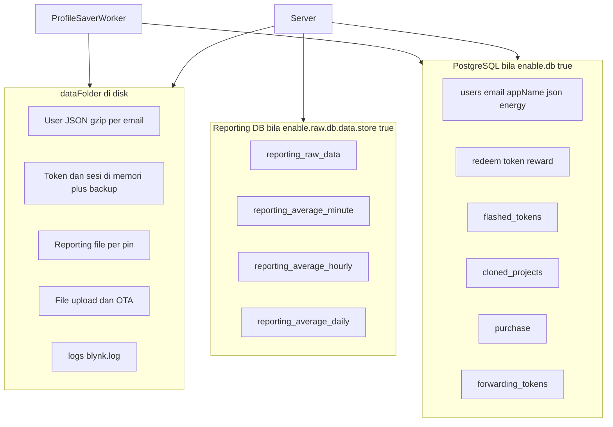

Skema ada di `create_schema.sql` dan `reporting_schema.sql`. Tanpa DB, semua profil tersimpan sebagai file di `dataFolder`.

## 17. Batas, keamanan, dan properti penting

Batas dari `Limits.java` dan `server.properties`:

- 50 device per user, 100 tag, 100 dashboard, profil maks 256 KB, widget maks 20 KB
- 100 pesan per detik per user, antrean notifikasi 2000, pool blocking 6
- Idle hardware 10 detik, idle app 300 detik
- Request web maks 512 KB, terminal 25 string, map 25, lcd 6, table 100 baris
- Simpan profil tiap 60 detik, cetak stats tiap 60 detik

Keamanan:

- TLS di 9443 dengan sertifikat bawaan hanya untuk coba lokal, bukan produksi
- `IpFilterHandler` untuk path `/admin`
- Cookie admin dan token reset password dengan `TokensPool` dan expiry
- Validator email dan domain, hash SHA256 untuk password
- ACME otomatis lewat `AcmeClient` dan `CertificateRenewalWorker`, atau LetsEncrypt manual, atau sertifikat sendiri via `server.ssl.cert` dan `server.ssl.key`
- `QuotaLimitChecker` menolak spam hardware dan webhook

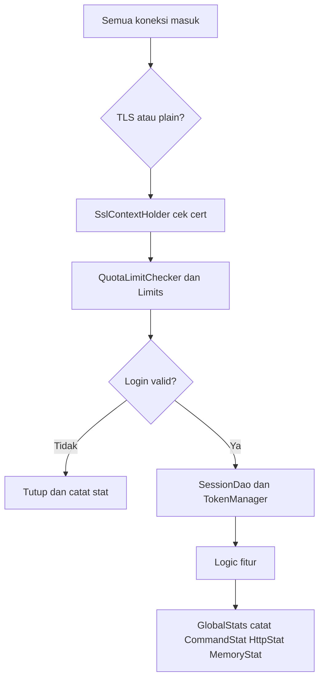

## 18. Klien dan tools

- `client/ClientLauncher` menjalankan mode hardware atau app dari CLI untuk uji manual.
- `HardwareClient` dan `AppClient` memakai decoder yang sama dengan server untuk replay.
- `CommandParserUtil` memparsing perintah konsol seperti tulis pin dan baca pin.
- `tools/ForwardingTokenGenerator` membuat token forwarding antar server.
- `tools/ReportingDataCleaner` membersihkan data reporting lama dari disk.

## 19. Cara jalan singkat

Pakai Java 11 dan folder data yang sudah ada:

```sh
java -jar server-0.41.16.jar -dataFolder /path/data
```

Port default 8080 untuk hardware dan HTTP, 9443 untuk app dan HTTPS, 8440 untuk MQTT. Detail install Raspberry Pi, Docker, mail, SMS, storage mentah, dan sertifikat ada di `blynk-server/README.md` dan `blynk-server/new_server_install.md`.

## 20. Daftar file rujukan

- `blynk-server/README.md` untuk install dan daftar isi lama
- `blynk-server/apiary.apib` untuk contoh REST lengkap
- `blynk-server/server/core/src/main/resources/server.properties` untuk semua properti
- `blynk-server/server/core/src/main/java/cc/blynk/server/core/protocol/enums/Command.java` untuk semua command
- `blynk-server/server/http-api/` untuk semua endpoint REST
- `blynk-server/server/http-admin/` untuk semua endpoint admin
- `blynk-server/server/launcher/` untuk boot dan worker
- `blynk-server/docs/` untuk gambar dan contoh WebSocket
