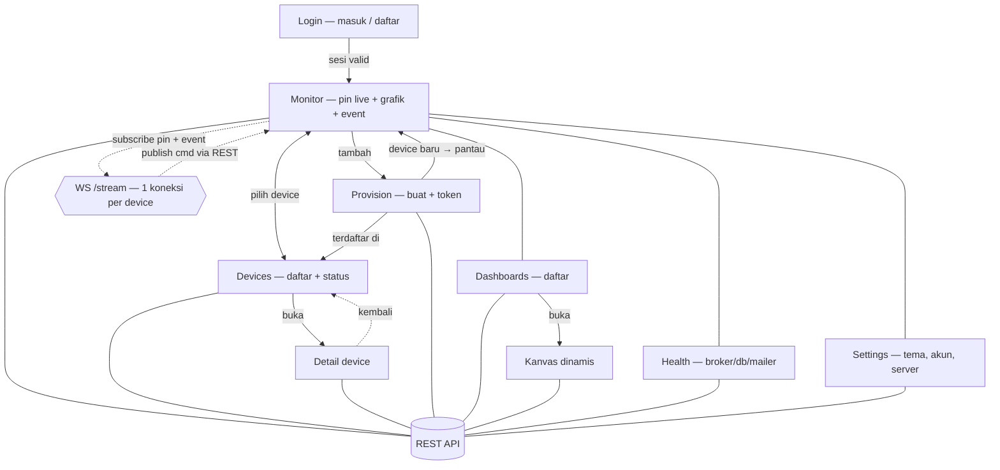

# Implementation Plan: VOLTA. Web Client (Next.js + TSX)

## Overview

Klien web untuk server VOLTA.: pantau pin live per device via WebSocket,
lihat history dalam grafik, kirim perintah ke pin, provision device baru,
dan cek kesehatan server. Satu codebase Next.js (App Router + TypeScript)
di folder `webapp/`, independen dari crate Rust dan firmware. Server tetap
satu-satunya sumber kebenaran; webapp tidak menyimpan state device sendiri.

Status task lama tidak disentuh: `tasks/plan.md` + `tasks/todo.md` tetap
milik server Rust (selesai 100%). Task webapp hidup di file ini dan
`tasks/todo-webapp.md`.

## Architecture Decisions

- **Next.js App Router + TypeScript**, folder `webapp/` di root repo.
  Alasan: satu deploy untuk UI + BFF proxy; tim sudah di Node 22.
- **BFF proxy, bukan CORS.** Semua REST lewat Next.js route handlers
  (`/api/[...path]` → `VOLTA_API_URL`). Alasan: server Rust tidak
  mengirim header CORS; proxy menghindari preflight dan menyembunyikan
  origin server. WebSocket tetap langsung ke server dengan `?token=`
  (server sudah mendukung token via query, teruji di `dashboard.html`).
- **Auth: httpOnly cookie + endpoint ws-token.** Login via BFF menyimpan
  token di cookie httpOnly; klien mengambil token WS sekali pakai lewat
  `GET /api/ws-token` hanya saat membuka stream. Alasan: token tidak
  diam di `localStorage`, sesi selamat refresh, SSR tetap bisa.
- **shadcn/ui sebagai primitif, bukan tampilan.** Pakai komponen
  (button, input, select, table, tabs, switch) tapi seluruh token
  diganti ke sistem desain dealt (di bawah). Alasan: aksesibilitas +
  perilaku bawaan shadcn, tanpa rupa default shadcn.
- **Grafik SVG buatan sendiri** (port logika `dashboard.html` yang sudah
  lolos uji visual: 1 garis, 4 gridline, tick bulat, tanpa legenda).
  Alasan: aturan app-screen melarang default library grafik.
- **Art direction: `data-terminal`** (deal `draw.mjs --app`, seed
  870858627, folder `.taste-skill/app-webapp/`). Alasan: sesi pantau
  lama; bahasa yang sama dengan prototipe `dashboard.html` yang sudah
  lolos look-round. Aksen tembaga `#C07A24` dari logo sebagai satu-satunya
  garis 1px (seleksi, garis grafik, dot). Dua tema penuh:
  gelap (ground `#101012`) dan terang (ground `#F5F3EE`), token di bawah.
- **Wajah produk**: mark Bit Pair (SVG dua kotak, dari `assets/logo/`)
  di rail, angka tabular IBM Plex Mono, teks Montserrat, ticker pin live
  + feed event sebagai signature element.
- **Satu pertanyaan layar**: "device saya melaporkan apa sekarang?"
  Blok terbesar = pin live + grafik pin terpilih.

### Token desain (gelap / terang)

| Token | Gelap | Terang |
|---|---|---|
| `--ground` | `#101012` | `#F5F3EE` |
| `--surface` | `#17171A` | `#FFFFFF` |
| `--raised` | `#1F1F23` | `#EDEAE3` |
| `--border` / `--rule` | `#2B2B2E` / `#1C1C1F` | `#E3DED4` / `#EFEBE2` |
| `--text` / `--muted` | `#F5F3EE` / `#A8A8AB` | `#111111` / `#5F6368` |
| `--accent` | `#C07A24` | `#A3651B` (kontras teks 4.5:1) |
| `--positive` / bg | `#3FC07A` / `#172A1D` | `#247B50` / `#DCFAE5` |
| `--negative` / bg | `#E5566F` / `#2C1A20` | `#C4242A` / `#FFEBE9` |

Catatan: nilai final dikunci saat implementasi T1 dan diverifikasi
dengan contrast checker (teks normal ≥ 4.5:1, besar ≥ 3:1).

## Struktur tab & live-wiring

Enam tab di rail (desktop) / bottom-bar (mobile): Monitor, Devices,
Provision, Dashboards, Health, Settings. Halaman detail hanya dicapai
dari daftar, tidak duduk di tab. Tanpa sesi semua tab mengarah ke login;
device yang dipilih dibagikan antar tab.

Panah tegas = navigasi antar layar. Panah titik-titik = aliran data live.
Semua layar baca-tulis lewat REST (`/api/*`); pin live dan event hanya
lewat satu koneksi WS per device terpilih; perintah tulis kembali via REST.

| Tab | Berisi | Terhubung ke |
|---|---|---|
| Monitor | Pin live, grafik history, feed event, kirim perintah, strip kesehatan | Devices (ganti device pantauan); Provision (tambah bila kosong); Settings (tema/akun) |
| Devices | Daftar + status online/offline jujur | Detail device (dipilih); Provision (bila kosong) |
| Detail device | Pin, grafik, perintah, status, hapus (dicapai dari daftar) | Kembali ke Devices |
| Provision | Form buat device, token sekali tampil + salin, tabel + hapus 2 tahap | Device baru langsung bisa dipilih di Monitor dan Devices |
| Dashboards | Daftar dashboard | Kanvas dinamis (W10) per dashboard |
| Health | Broker, db, mailer, statistik (sumber sama dengan strip Monitor) | Strip di Monitor memakai sumber data yang sama |
| Settings | Tema gelap/terang, akun + keluar, info server, status WS + sambung ulang | Dibuka dari rail/bottom-bar; tidak memutus pantauan |

## Task List

### Fase 0 — Fondasi

#### Task W1: Scaffold webapp + sistem desain dua tema
**Description:** Inisialisasi Next.js (App Router, TS strict), Tailwind,
shadcn/ui, token CSS dua tema, font Montserrat + IBM Plex Mono, rail ikon
6 tab + bottom bar mobile, halaman kosong tiap view.

**Acceptance criteria:**
- [ ] `npm run build` lolos tanpa error TS
- [ ] Toggle tema gelap/terang bekerja, tersimpan, tanpa flash saat load
- [ ] Rail 56px desktop, bottom bar mobile; semua ikon punya label aksesibel

**Verification:**
- [ ] `npm run build`, `npx tsc --noEmit`, `npm run lint`
- [ ] Manual: buka `/`, ganti tema, reload, cek tidak ada flash

**Dependencies:** tidak ada (baca `.taste-skill/app-webapp/direction.json` dulu)

**Files likely touched:**
- `webapp/` (scaffold baru)

**Estimated scope:** M (scaffold + tokens + shell)

#### Task W2: BFF proxy + auth
**Description:** Route handler `/api/[...path]` meneruskan ke
`VOLTA_API_URL` dengan header auth dari cookie httpOnly; halaman login /
daftar; `GET /api/ws-token` untuk token WS; logout menghapus cookie.

**Acceptance criteria:**
- [ ] Login berhasil menyimpan cookie httpOnly (bukan localStorage)
- [ ] Register lalu auto-login jalan
- [ ] Token salah / kadaluarsa mengembalikan ke login dengan pesan jelas
- [ ] `/api/ws-token` menolak tanpa sesi valid

**Verification:**
- [ ] Vitest untuk helper cookie/proxy + Playwright: login/logout
- [ ] Manual lawan server Rust asli di `localhost:9443`

**Dependencies:** W1

**Files likely touched:**
- `webapp/app/api/[...path]/route.ts`
- `webapp/app/api/ws-token/route.ts`
- `webapp/app/login/page.tsx`

**Estimated scope:** M (3–5 file)

### Checkpoint A — Fondasi
- [ ] Build + typecheck + lint hijau
- [ ] Login/logout end-to-end lawan server Rust asli
- [ ] Review arah visual (screenshot 1440 + 390) sebelum lanjut

### Fase 1 — Inti monitoring

#### Task W3: Shell + strip kesehatan
**Description:** Shell final (rail, bottom bar, judul per view), strip
kesehatan 5 sel dari `/healthz` + `/admin/stats`, freshness stamp.

**Acceptance criteria:**
- [ ] Strip menampilkan broker/db/mailer/pending/device online/msgs
- [ ] Server mati → kartu "unreachable" eksplisit, bukan angka basi
- [ ] Angka dihitung dari respons, bukan diketik manual

**Verification:**
- [ ] Playwright: matikan server → strip menunjukkan unreachable
- [ ] Manual: bandingkan angka dengan `curl /healthz`

**Dependencies:** W2

**Files likely touched:**
- `webapp/app/(shell)/layout.tsx`
- `webapp/components/health-strip.tsx`

**Estimated scope:** S (1–2 file)

#### Task W4: Daftar + pilih device
**Description:** Daftar device (nama, status online/offline jujur dari
`GET /devices/{id}/status`), selektor device aktif, state kosong
("belum ada device") dan error jaringan.

**Acceptance criteria:**
- [ ] Device offline tampil pill netral + teks, bukan angka basi
- [ ] Tanpa device: empty state + ajakan ke provisioning
- [ ] Pilih device mengganti seluruh konten monitor

**Verification:**
- [ ] Vitest untuk helper status/teks "x lalu"
- [ ] Manual: cabut device, pastikan pill berubah ≤ 30 dtk (batas sweeper server)

**Dependencies:** W2

**Files likely touched:**
- `webapp/components/device-list.tsx`
- `webapp/lib/format.ts`

**Estimated scope:** S (1–2 file)

#### Task W5: Pin live + kirim perintah
**Description:** Baris pin (nilai tabular kanan, "x lalu", penanda basi),
WS `/stream?token=` dengan reconnect backoff, feed event, form kirim
perintah (`PUT .../pins/{pin}`) dengan konfirmasi hasil/gagal.

**Acceptance criteria:**
- [ ] Nilai pin update live tanpa reload
- [ ] WS putus → indikator "Reconnecting", lalu pulih otomatis
- [ ] Kirim perintah sukses/gagal memberi umpan balik teks (bukan warna saja)
- [ ] Pin non-numerik tampil apa adanya, tidak merusak layout

**Verification:**
- [ ] Playwright lawan server + device uji (atau stub WS): kirim → pin berubah
- [ ] Manual: cabut kabel device, pastikan status offline ≤ ~30 dtk

**Dependencies:** W4 (butuh device terpilih)

**Files likely touched:**
- `webapp/hooks/use-device-stream.ts`
- `webapp/components/pin-list.tsx`
- `webapp/components/command-form.tsx`

**Estimated scope:** M (3–4 file)

#### Task W6: Grafik history
**Description:** SVG buatan sendiri per aturan app-screen: 1 garis tembaga
2px, 3–5 gridline, tick bulat di atas maksimum, label jam tidak bertumpuk,
hover dot + tooltip teks, rentang 1H/24H, state kosong jujur.

**Acceptance criteria:**
- [ ] Pin non-numerik diabaikan dengan catatan jumlah sampel
- [ ] Rentang kosong menampilkan garis nol + satu kalimat (bukan panel kosong)
- [ ] Hover menampilkan nilai + waktu; tidak ada label bertumpuk di 390px

**Verification:**
- [ ] Vitest untuk fungsi skala/tick (tick bulat, top di atas maks)
- [ ] Screenshot 1440 + 390 diperiksa manual

**Dependencies:** W4

**Files likely touched:**
- `webapp/components/history-chart.tsx`
- `webapp/lib/chart-scale.ts`

**Estimated scope:** M (2–3 file)

### Checkpoint B — Inti jalan
- [ ] Login → pilih device → pin live → kirim perintah → grafik, semua lawan server + device asli
- [ ] `npm run build && npx tsc --noEmit` hijau
- [ ] Screenshot 1440/768/390 diperiksa (tidak ada panel void, angka konsisten)

### Fase 2 — Lengkap

#### Task W7: Provisioning
**Description:** Form buat device (nama) → tampilkan ID + token sekali
dengan tombol salin + langkah flash; tabel device dengan hapus dua tahap.

**Acceptance criteria:**
- [ ] Token hanya tampil sekali setelah create, plus tombol salin
- [ ] Hapus butuh konfirmasi kedua ("Sure?")
- [ ] ID panjang tampil 8 karakter + ellipsis, bukan tabel melebar

**Verification:**
- [ ] Playwright: create → token tampil → delete
- [ ] Manual: token hasil create dipakai provisioning firmware asli

**Dependencies:** W2

**Files likely touched:**
- `webapp/app/(shell)/provision/page.tsx`
- `webapp/components/copy-button.tsx`

**Estimated scope:** S (1–2 file)

#### Task W8: Halaman detail device
**Description:** Satu device per halaman: pin + grafik + kirim perintah +
status + tombol hapus; navigasi daftar ↔ detail.

**Acceptance criteria:**
- [ ] Deep link `/devices/[id]` langsung membuka device benar
- [ ] ID tak dikenal → pesan jelas, bukan halaman kosong
- [ ] Layout ulang pakai komponen Fase 1 (tidak duplikasi logika)

**Verification:**
- [ ] Playwright: buka deep link langsung (tanpa klik dari daftar)
- [ ] Manual 390px: konten jadi satu kolom tanpa scroll horizontal

**Dependencies:** W4, W5, W6

**Files likely touched:**
- `webapp/app/(shell)/devices/[id]/page.tsx`

**Estimated scope:** S (1–2 file + reuse)

#### Task W9: Kontrol OTA
**Description:** Tombol mulai/stop OTA per device (`/ota/start|stop`),
status dari respons, konfirmasi sebelum mulai.

**Acceptance criteria:**
- [ ] Start/stop memanggil endpoint benar dan menampilkan hasilnya
- [ ] Gagal (device offline) tampil sebagai teks error, bukan diam

**Verification:**
- [ ] Playwright: start lalu stop, respons tercatat
- [ ] Manual lawan device asli bila tersedia

**Dependencies:** W4

**Files likely touched:**
- `webapp/components/ota-controls.tsx`

**Estimated scope:** XS (1 file)

### Task W12: Editor visual dashboard

**Description:** Ubah kanvas W10 dari read-only menjadi bisa disusun:
palet kind widget, tambah via klik, pindah via drag dalam grid 12 kolom,
panel properti (pin, label, min/max, warna), simpan via PUT/POST/DELETE
yang sudah ada. Layout disimpan di `config` (`{x, y, w, h, order}`).

**Acceptance criteria:**
- [ ] Tambah / pindah / hapus widget tanpa sentuh API mentah
- [ ] Refresh memuat susunan yang sama (bukti persistensi)
- [ ] Perubahan tak sengaja tidak tersimpan (tombol Simpan eksplisit per panel)

**Verification:**
- [ ] Playwright: tambah → pindah → reload → susunan sama → hapus
- [ ] Manual: editor bisa dipakai orang non-teknis tanpa baca docs

**Dependencies:** W8, W10 (butuh renderer + API widget lengkap)

**Files likely touched:**
- `webapp/app/(dashboards)/[id]/edit/page.tsx` (atau mode edit di kanvas)
- `webapp/components/widget-palette.tsx`
- `webapp/components/widget-props.tsx`

**Estimated scope:** M (3–4 file)

### Task W13: Wajah SaaS (branding, berbagi, peran)

**Description:** Terapkan branding per user (judul, logo, aksen dari
`GET /branding`), halaman publik read-only `/s/[token]` (tanpa login,
tanpa kontrol tulis), dan badge peran: viewer tidak melihat tombol
tulis/hapus di mana pun.

**Acceptance criteria:**
- [ ] Ganti brand → judul, logo, aksen ikut berubah setelah login ulang
- [ ] Link berbagi dibuka tanpa login: baca saja, tanpa tombol tulis
- [ ] Token dicabut → halaman berbagi jadi 404 yang jelas

**Verification:**
- [ ] Playwright: buat share → buka tanpa sesi → read-only → cabut → 404
- [ ] Manual: cek viewer tidak bisa memicu satu pun request tulis (pantau network)

**Dependencies:** W8 (detail sebagai basis view publik), S5 + S7 server

**Files likely touched:**
- `webapp/app/s/[token]/page.tsx`
- `webapp/components/brand-provider.tsx`
- `webapp/lib/permissions.ts` (satu gerbang `bolehNulis`)

**Estimated scope:** M (3 file)

### Task W14: Pengaturan (tema, akun, server)

**Description:** Layar Settings: toggle tema gelap/terang (tersimpan),
baris akun (email + tombol Keluar), info server (URL basis + status
terhubung), status koneksi WS + tombol "Sambung ulang" manual.

**Acceptance criteria:**
- [ ] Ganti tema langsung berlaku dan bertahan setelah reload
- [ ] Keluar menghapus sesi dan mengarah ke login
- [ ] WS putus terlihat statusnya; tombol sambung ulang menyambung kembali

**Verification:**
- [ ] Playwright: ganti tema → reload → tema bertahan
- [ ] Manual: matikan server → status WS berubah → nyalakan → sambung ulang manual jalan

**Dependencies:** W1 (shell), W5 (status WS dipakai ulang)

**Files likely touched:**
- `webapp/app/(shell)/settings/page.tsx`
- `webapp/components/theme-toggle.tsx`

**Estimated scope:** S (1–2 file)

#### Task W10: Dashboard dinamis ala no-code engine
**Description:** Render dashboard murni dari definisi server
(`GET /dashboards`, `GET /dashboards/{id}/widgets` → `{id, kind, pin,
config}`), tanpa redeploy saat layout berubah. Registry widget:
satu file per kind (`widgets/gauge.tsx`, `button.tsx`, `switch.tsx`,
`slider.tsx`, `labeled-value.tsx`, `led.tsx`, `history-chart.tsx`) +
manifest (nama, skema config, ukuran default). Posisi/ukuran dibaca dari
`config` (`{x, y, w, h, label, min, max, unit}`); grid 12 kolom.
Binding live reuse hook WS Fase 1. Jujur seperti Blynk: *layout dan isi*
berubah tanpa rilis ulang; *jenis widget baru* tetap butuh kode klien.

**Acceptance criteria:**
- [ ] Tambah/hapus/pindah widget via API langsung tercermin tanpa rebuild
- [ ] Kind tak dikenal tampil sebagai kartu "kind belum didukung", bukan crash
- [ ] Live binding dan kirim perintah jalan untuk semua kind interaktif

**Verification:**
- [ ] Playwright: buat dashboard via API mentah, buka webapp, semua widget tampil + live
- [ ] Manual: ubah `config` widget di DB, refresh, layout ikut berubah

**Dependencies:** W4, W5, W6

**Files likely touched:**
- `webapp/components/widgets/*.tsx`
- `webapp/lib/widget-registry.ts`
- `webapp/app/(shell)/dashboards/[id]/page.tsx`

**Estimated scope:** M (registry + 7 renderer + halaman)

#### Task W11: Widget HTML kustom (sandbox)
**Description:** Widget kind `html` berisi `{html, css?, js?}` yang
dirender dalam `<iframe sandbox="allow-scripts" srcDoc=...>` tanpa
`allow-same-origin`: terisolasi, tak bisa menyentuh DOM/storage induk.
Jembatan `postMessage` dua arah yang sempit: widget → induk hanya
`{type:"cmd", pin, value}` (induk yang validasi + teruskan via PUT);
induk → widget `{type:"pin", pin, value}` tiap update. Batas ukuran
64 KB per field (cek klien; cap server menyusul bila perlu).

**Acceptance criteria:**
- [ ] Contoh denah/unit test: HTML kustom bisa baca pin dan kirim perintah
- [ ] JS widget tidak bisa akses `parent`, cookie, atau localStorage induk
- [ ] Melebihi 64 KB ditolak dengan pesan jelas sebelum tersimpan

**Verification:**
- [ ] Playwright: suntik `parent.document` dari widget → harus gagal terisolasi
- [ ] Manual: pasang contoh denah denah + tombol dari HTML murni

**Dependencies:** W10 (butuh registry + binding)

**Files likely touched:**
- `webapp/components/widgets/html-widget.tsx`
- `webapp/lib/widget-bridge.ts` (protokol postMessage)

**Estimated scope:** S (2 file + contoh)

### Checkpoint C — Selesai
- [ ] Semua acceptance criteria W1–W14 terpenuhi
- [ ] Gate visual: `lint.mjs --app` 0 FAIL, `inspect.mjs --app` 0 FAIL di 1440/768/390, kritik 3 ronde tercatat
- [ ] Kontras teks ≥ 4.5:1 (cek tool), keyboard penuh (Tab/Enter/Escape), state empty/loading/error ada di tiap blok data
- [ ] Tidak ada data contoh/invented di mana pun; angka lolos uji "total dari baris"
- [ ] README webapp + README root diperbarui

## Risks and Mitigations

| Risk | Impact | Mitigation |
|---|---|---|
| Tampilan default shadcn menempel | Medium | Token CSS diganti total di T1; lint visual menolak radius/bayangan default |
| Kontrak API server berubah | Medium | BFF mewarisi bentuk respons; pin versi server di README webapp; uji lawan server asli tiap checkpoint |
| Token di URL WS tercatat di log | Low | Token query hanya untuk upgrade WS (sudah didukung server); dokumentasikan; pertimbangkan masa berlaku pendek di server |
| Font Google offline | Low | Fallback stack system-ui + mono sistem; tetap lolos tanpa unduhan |
| Server mati saat demo | Low | State "unreachable" eksplisit di tiap blok (sudah jadi pola di T3–T6) |

## Open Questions

- Target hosting webapp (mesin yang sama / Vercel / lain)? Menentukan `VOLTA_API_URL` + strategi build. Default rencana: env var saat build, didokumentasikan di webapp README.
- Apakah dashboard/widget masuk v1? Ya — masuk sebagai W10–W13 (keputusan: no-code engine + HTML widget + editor + wajah SaaS).
- Retensi history default grafik (1H/24H) cukup, atau perlu 7D? Butuh jawaban sebelum T6 final (default: cukup).

## Verification (global)

- [ ] `npm run build`, `npx tsc --noEmit`, `npm run lint` hijau tiap checkpoint
- [ ] Playwright critical path hijau tiap checkpoint
- [ ] Uji manual selalu lawan server Rust + device/ESP32 asli, bukan mock, untuk klaim "jalan"
